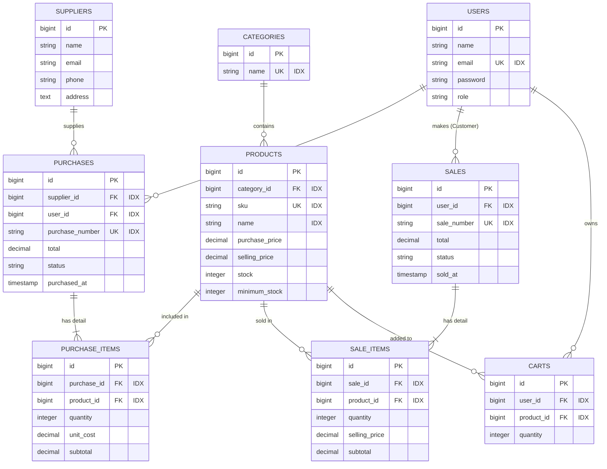

# Orvélo - Premium Footwear (E-Commerce & Inventory System)


## 1. Project overview
Orvélo adalah sistem informasi terintegrasi berbasis web yang memadukan etalase toko *online* (e-commerce) khusus produk alas kaki premium dengan sistem manajemen inventaris (gudang) di belakang layar. Proyek ini dikembangkan sebagai bentuk implementasi praktis untuk pemenuhan tugas Ujian Tengah Semester (UTS) mata kuliah Web Programming 2.

Aplikasi ini mengusung arsitektur *Role-Based Access Control* (RBAC) yang memisahkan antarmuka menjadi dua bagian utama: **Storefront** interaktif untuk pelanggan melakukan transaksi mandiri melalui fitur keranjang belanja, dan **Admin Dashboard** terpusat bagi staf untuk mengelola data master, arus barang masuk (restok), serta memantau laporan. Nilai utama dari sistem Orvélo adalah kemampuannya dalam melakukan sinkronisasi data secara otomatis; setiap pesanan yang berhasil di-*checkout* akan langsung memotong sisa stok di gudang secara *real-time*, lengkap dengan perlindungan validasi pencegahan stok minus.

## 2. Requirements
Kebutuhan sistem untuk menjalankan aplikasi ini di lingkungan lokal:
* PHP >= 8.1
* Composer
* XAMPP (untuk Apache dan MySQL/MariaDB)
* Git

## 3. Installation
Langkah-langkah untuk mengunduh proyek ke komputer Anda:
1. Buka terminal/Command Prompt dan arahkan ke folder `htdocs` pada XAMPP Anda.
2. *Clone* repositori ini:
   ```bash
   git clone [https://github.com/username-anda/nama-repo-anda.git](https://github.com/username-anda/nama-repo-anda.git)

- Masuk ke direktori proyek yang baru saja diunduh:
Bash
cd nama-repo-anda

- Instal seluruh dependensi framework menggunakan Composer:
Bash
composer install

## 4. Environment setup
Pengaturan lingkungan sistem dan koneksi database:

Salin file konfigurasi environment dari bawaan Laravel:

Bash
cp .env.example .env
Hasilkan application key acak untuk keamanan Laravel:

Bash
php artisan key:generate
Buka XAMPP Control Panel, lalu jalankan modul Apache dan MySQL.

Buka browser, akses http://localhost/phpmyadmin, lalu buat database baru yang kosong dengan nama orvelo_db.

Buka file .env di VS Code, lalu sesuaikan blok koneksi database menjadi seperti ini:

Cuplikan kode
DB_CONNECTION=mysql
DB_HOST=127.0.0.1
DB_PORT=3306
DB_DATABASE=orvelo_db
DB_USERNAME=root
DB_PASSWORD=

## 5. Migration & seeding
Membangun struktur tabel database beserta datanya:

Jalankan perintah migrasi beserta seeder di terminal:

Bash
php artisan migrate --seed
Nyalakan server lokal Laravel:

Bash
php artisan serve
Akses aplikasi melalui browser di tautan: http://localhost:8000

## 6. Demo account
Gunakan kredensial berikut untuk menguji sistem (Role-Based Access Control):

- Admin (Akses Dashboard & Inventaris): admin@gmail.com | Password: password123

- Customer (Akses Etalase & Transaksi): customer@gmail.com | Password: password123

- Staff (Akses Dasboard & Inventaris): staff@gmail.com | Password: password123

## 7. Features
Fitur utama yang dipersyaratkan dan tersedia di aplikasi Orvélo:

- Authentication: Login/logout dan pemisahan hak akses panel secara ketat.
- Master Data: Fitur CRUD lengkap untuk tabel Kategori, Produk, dan Supplier.
- Purchasing: Pencatatan stok masuk dari pemasok untuk menambah jumlah barang di gudang.
- Sales & Cart: Transaksi etalase interaktif yang mendukung pembelian banyak tipe barang sekaligus.
- Automated Stock: Pengurangan sisa barang otomatis saat checkout dan validasi pencegahan transaksi jika melebihi stok gudang.
- Navigation: Fitur pencarian nama produk, filter kategori kustom, dan navigasi pagination.

## 8. Known limitations
Kekurangan atau batasan pada sistem versi saat ini:

- Belum terintegrasi dengan Payment Gateway pihak ketiga (masih berupa simulasi kasir potong stok).
- Fitur cetak bukti pembayaran (invoice) masih mengandalkan fitur print dialog bawaan dari browser.
- Ongkos kirim tidak dihitung secara dinamis karena belum ada integrasi API pihak logistik pengiriman.

## 9. Entity Relationship Diagram (ERD)
Berikut adalah struktur relasi database sistem, mencakup penanda Primary Key (PK), Foreign Key (FK), Unique Key (UK), dan Index (IDX) untuk optimasi pencarian.

